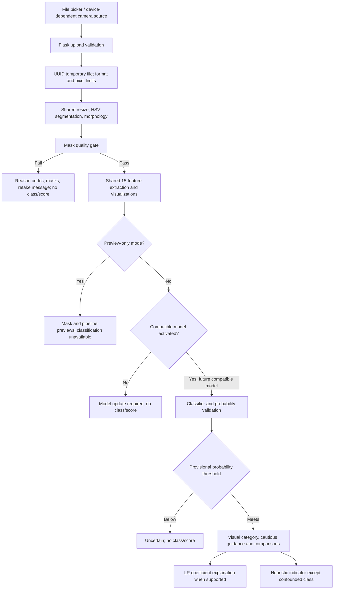
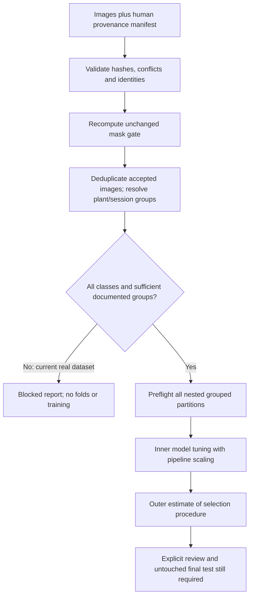

# Software Design Description — Lecor

> Whole-plant extension, 2026-10-13: a separate experimental classifier now runs via `run_wholeplant.py`. No validated classifier exists yet, and development results cannot be presented as performance. [Current implementation, design, tests and limitations](wholeplant_implementation.md). The original Stage 1–6 single-leaf baseline below is retained as historical evidence; its blocked-classification statements describe that baseline.

Version: Stage 6 implementation, 2026-10-09.

**No validated classifier exists yet. Classification results cannot be presented as performance.** The current deliverable is a visual-processing and quality-review prototype. Classification code is retained and tested with fixtures; the original model is incompatible with current preprocessing and the model contract.

## Purpose and scope

Lecor accepts a single RGB-camera image and investigates numerical color and projected-shape descriptors. It uses Flask, OpenCV and scikit-learn. It does not measure plant water content, establish symptom cause or prescribe treatment. Preview-only mode is the supported current demonstration.

## Runtime data flow

The current dataset cannot supply the future compatible classifier in this diagram. Preview-only mode skips model deserialization entirely and disables classification even if an estimator is present in memory. Direct normal startup refuses a missing/incompatible model; explicit preview startup proceeds. Temporary files are removed on success and failure.

## Offline development flow

Ablations use the same grouped evaluator and partitions. They do not change production features or save production models. The historical `train_model.py` remains an explicitly labelled image-level trainer; it is not the grouped evaluation pathway. Training never occurs in a web request.

## Module responsibilities

| Module | Responsibility |
|---|---|
| `config.py` | Project-relative paths, named preprocessing/gate limits, server settings, preview flag |
| `feature_extraction.py` | Shared image preparation, gate, 15 production features, visualizations, heuristic/advisory, isolated experimental features |
| `app.py` | Upload lifecycle, JSON errors, guarded inference, preview mode and templates |
| `model_contract.py` | Schema/version/library validation; exact LR score contributions |
| `dataset_manifest.py` | Image inventory, hashes, duplicate conflicts and conservative identity resolution |
| `build_dataset.py` | Import-safe gate-passing versioned CSV plus metadata |
| `evaluate_grouped.py` | Class/group readiness, nested grouped evaluation and separate legacy diagnostics |
| `ablate_features.py` | Five grouped feature experiments; synthetic-only execution until real readiness |
| `train_model.py` | Historical image-level comparison and versioned model writer with provenance |
| `templates/index.html` | Upload/preview/pipeline/results, stale-state prevention, readable errors and browser printing |
| `timing_preview.py` | In-process preview endpoint p50/p95; never classification-performance evidence |
| `record_test_run.py` | Actual pytest XML/logs, package inventory, frontend and dependency checks |
| `generate_test_results.py` | Render actual recorded test evidence into a Markdown report |

## Data and persistence

The manifest contains 56 physical files, 40 distinct hashes and 16 exact copies. Human plant/leaf/session/source/label-method fields are unknown and remain blank. The unchanged quality gate accepts Healthy 4 and Disease Confounded 7, with no Moderate or Severe images. The selected-mask border fraction is diagnostic only.

Original dataset/model/CSV/benchmark and backup hashes are preserved. Generated artifacts have unique versioned names and exclusive creation. A new model records ordered schema, schema/extractor/preprocessing versions, dataset CSV hash, library/Python versions, training date and actual CV protocol. Matching metadata does not establish scientific validity. Models must come from trusted sources because joblib/pickle deserialization can execute code.

Uploads are not database records. The application maintains no longitudinal scan history. Browser object URLs are revoked when replaced or cleared. There is no user-account or cloud upload service.

## Design decisions and limits

- Keep a small, inspectable OpenCV/scikit-learn architecture appropriate to an academic prototype.
- Use one production extraction path in training and inference; experimental features never enter production without approval.
- Prefer refusal to unsupported inference: reject bad masks, incompatible metadata and invalid probabilities.
- Keep all known plant views together; session fallback is conservative but cannot prove plant independence.
- Distinguish dataset comparisons from model contributions and both from biological causes.
- Use explicit preview mode so a demonstration can proceed honestly while classifier readiness is blocked.
- Keep localhost/debug-off defaults. Browser/device capture, printing, HTTPS deployment and cross-browser behavior require separate acceptance checks.

See `environment.md`, `requirements_traceability.md`, `STD.md` and `limitations.md` for the reproducible environment, acceptance status and known limitations.
