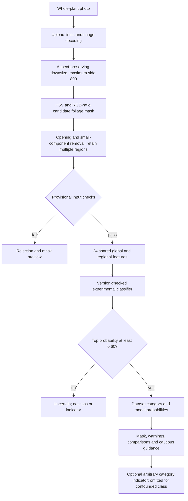

# Whole-plant implementation — 13 October 2026

The guide's whole-plant-photo requirement is implemented as **whole-photo candidate-foliage assessment**. A trained experimental classifier runs end to end. No scientifically validated classifier exists yet; development classification numbers cannot be presented as final performance.

## Decision and tradeoffs

| Approach | Benefit | Main tradeoff | Decision |
|---|---|---|---|
| Whole foliage mask + global and vertical-region features | Accepts overlapping foliage; laptop-friendly; one training row per original photo; existing stack retained | Cannot isolate every leaf, remove every green background or infer hidden symptoms | Implemented baseline |
| Segment every leaf, classify, then aggregate | Local results could reveal heterogeneous symptoms | Overlap/occlusion makes separation unreliable; no leaf-instance annotations or leaf-level labels here; cannot assume plant label applies to each leaf | Defer; do not claim every leaf was evaluated |
| User-assisted plant crop/mask | Helps exclude neighboring plants/supports while retaining cheap models | Extra interaction; manual masks must also be used consistently for training | High-value next experiment, not implemented |
| CNN/instance segmentation | May learn richer visual structure | 44 images cannot justify a new deep model; annotation/data and maintenance cost; conflicts with retained architecture | Not introduced |
| Repeat standardized full-plant photos over time | Within-plant changes can reduce variety/age confounding | Needs recorded identities, controlled framing and additional sessions | Recommended data-collection extension |

Controlled capture is the preferred operating protocol: one tomato plant, full plant in view, plain neutral background, diffuse light. Existing garden images can be processed, but their masks and results are less trustworthy. The app cannot automatically establish that exactly one complete plant is shown. Frame contact is explicitly flagged, and the scope remains **visible foliage in this photo**.

## Actual pipeline

`plant_features.prepare_plant` performs segmentation and input checks; `extract_features` is shared by `train_wholeplant.inventory` and `analyze_plant_full` at inference. `app.predict` retains the secure upload, cleanup and error handling. The selected pipeline is loaded once; training never occurs during a request.

New features are separate from the original 15-feature contract. The 24 measurements are HSV means/std (6), RGB means (3), GLI mean (1), normalized R/G means (2), LAB a*/b* means/std (4), yellow/dark color fractions (2), and GLI/yellow fraction in each of three vertical bands (6). Bands span the selected foreground's vertical bounding range; empty bands use the corresponding global mean. LAB is not illumination-invariant. Linear hue statistics retain wrap-around limitations. Global/regional means are correlated and not biological causes. No shape/curl or absolute canopy-size inputs are used.

The final candidate mask adds green/red and green/blue ratios to HSV to exclude many warm soil/skin pixels. Brown, shaded or pale foliage may be lost; green backgrounds/supports and some soil/fruit may remain. Mask overlays are inspection aids, not ground-truth segmentation. Uniform green is rejected, but a green non-plant object can still pass. No claim of robust semantic plant detection is made.

## Dataset and reproducibility

Downloaded the supplied Drive folder into `dataset_wholeplant_v1_20261013/`: 44 decodable images, 11 per class, no byte-identical duplicates. All 44 pass the limited new foliage gate. Do not confuse this with the old single-leaf gate: its settings and results have not changed. Many new photographs are close-ups or include neighboring foliage; full-plant framing is not consistently represented.

Automatic 64-bit dHash screening at distance ≤8 found no candidate pairs; it does not rule out related photos. Visual review shows similar scenes that need identity checking. Plant count, session count, device, actual source and physiological label method remain **unknown**. Manifest fields are intentionally empty. The source folder records supplied labels, not independent diagnostic proof.

The active bundle is in `artifacts/wholeplant_v1_20261013T073335Z_cbc353aa/`, selected by `wholeplant_deployment_v1.json`. It records schema/extractor/preprocessing versions, all feature names in order, feature-CSV SHA-256 (including source-image hashes), exact library/Python versions, UTC date, CV protocol and fitted models. Runtime validation prevents mixing leaf/plant contracts or preprocessing versions. The initial mask-review experiment in `artifacts/wholeplant_v1_20261013T073154Z_65109f98/` is retained for transparency, is not deployed, and is incompatible with the final mask signature. Its higher diagnostic score is not evidence that including more background was better.

## Development diagnostics — NOT independent performance

Fixed stratified 5-fold image-level CV with seed 42; one row per byte-unique image. No plant/session groups can be verified. Scalers and SVM sigmoid calibration remain inside training folds. Fixed candidates:

- LR: StandardScaler + L2 LogisticRegression, C=0.3, max_iter=2000.
- SVM: StandardScaler + RBF SVC, C=1, gamma=scale, CalibratedClassifierCV with 3 internal folds.
- RF: 200 trees, max_depth=4, min_samples_leaf=2, seed=42.

Selection uses pooled out-of-fold Macro F1, then balanced accuracy, then fixed LR/SVM/RF order without rounding. All candidates are subsequently fitted on all 44 images. There is no held-out final test set. Candidate selection and iterative mask development further limit interpretation. Near-duplicate, identity, background and label confounding remain unresolved. RF probabilities are not independently calibrated, and the 0.60 threshold is provisional rather than an out-of-distribution guarantee.

| Candidate | Image-level development accuracy | Macro F1 | Balanced accuracy |
|---|---:|---:|---:|
| Logistic Regression | 0.4318 | 0.4249 | 0.4318 |
| RBF SVM | 0.4091 | 0.3890 | 0.4091 |
| Random Forest (deployed experiment) | 0.4545 | 0.4324 | 0.4545 |

These low numbers do **not** support reliable detection. RF Severe recall is **1/11 (9.1%)**: five Severe images went to Moderate and five to Disease Confounded. Disease→water-stress count is 2; Healthy false-alert rate is 6/11. Full per-class metrics, confusion matrices and out-of-fold filenames are in the active `development_report.json`. Selecting the highest CV number does not make it an unbiased estimate. The difference between LR and RF does not establish statistical superiority.

## Functional verification

All 44 downloaded photos were sent through the real Flask `/predict` handler using its test client: 27 classified, 17 uncertain, no request failures. The returned classified labels include all four classes. This is a software check on training images, not predictive validation. Local p50=0.0995 s and p95=0.1950 s for these 44 requests, excluding model startup, browser and network; see `reports/wholeplant_functional_20261013T073750Z_aa73a2b5.json`. It does not prove REQ-013 on an ordinary target laptop/phone.

Python 3.13.0: 146 pytest cases passed. Python 3.14.5: 144 passed, two saved-deployment cases intentionally skipped due to exact runtime compatibility. Node frontend tests and pip dependency checks passed in both environments. Eleven existing SVC probability-deprecation warnings occur in historical Stage 4/5 tests; the new SVM uses CalibratedClassifierCV. Detailed evidence is in `docs/test_results.md`.

## What changed

| File or directory | Purpose |
|---|---|
| `plant_features.py` | Shared whole-photo foliage segmentation, gates, 24 features, previews and category indicator |
| `train_wholeplant.py` | Manifest/duplicate checks, explicit development-only CV, versioned model/report persistence |
| `run_wholeplant.py`, `wholeplant_deployment_v1.json` | Convenient separate deployment launcher and reviewed artifact selection |
| `config.py`, `app.py` | Explicit wholeplant mode; select shared extraction/signature; refuse wrong-mode models |
| `model_contract.py` | Validate both separate contracts, preserving legacy checks |
| `templates/index.html` | Whole-plant instructions, truthful feature count, mask/warnings and experimental notice |
| `verify_wholeplant.py` | Functional and local timing evidence across downloaded data |
| `tests/test_wholeplant.py` | New extraction, manifest, duplicate, schema, replay and end-to-end API regressions |
| `dataset_wholeplant_v1_20261013/`, `artifacts/` | Separate new data, manifests, feature CSVs, models and diagnostics; no original overwrites |
| `README.md`, `docs/`, `reports/` | Launch instructions, current design/limits, historical leaf reference and actual test records |

## What to show in the demo and what to say

1. Start `run_wholeplant.py` under the pinned Python 3.13 environment. Show the visible experimental notice.
2. Upload a whole-plant photo; show the mask, color maps and a categorical/uncertain result. Explain that all selected visible foliage is pooled, not that every leaf was individually recognized.
3. Show a blank/invalid photo rejection and explain why uncertainty is a valid result. A passing mask cannot guarantee a plant or its cause of symptoms.
4. If using supplied training images, explicitly identify them as training examples. Do not call demonstration predictions a test accuracy result.
5. Say: “This demonstrates the image-processing and classification workflow. The small dataset has unverified labels and identities, and the development results show poor Severe-stress recognition. It needs independent labelled plants before agronomic use.”

## What still needs the user

- Fill authentic plant/session/source/device/background/label-provenance fields; do not infer identity merely from filenames or assign every image a unique plant ID.
- Confirm which close-ups satisfy the guide's whole-plant requirement. Collect consistently framed full plants across **all** labels.
- Suggested starting target: at least 10 independently identified plants contributing to each class, across at least 3 sessions, with roughly 30 usable images/class. These are practical collection targets, **not statistically derived sample sizes or guarantees**. A plant can change class over time; retain its same ID and hold it wholly within one evaluation partition.
- Record an independent label method (controlled treatment and appropriate direct measurements/expert checks). Disease and water stress can coexist. Hold out whole plants and later sessions for a final test touched once.
- Complete phone/laptop camera, keyboard, print and cross-browser checks. No dedicated webcam capture workflow has been added.
- Review SRS leaf→whole-plant scope changes with the guide. The PDF has not been altered.

| Plant ID | Session/date | File | Observed label | Independent evidence/method | Device | Background | Split reserved |
|---|---|---|---|---|---|---|---|
| | | | | | | | |
